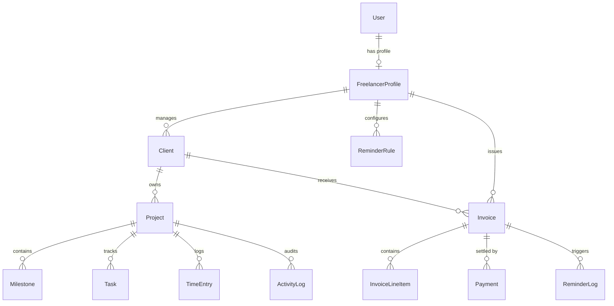

# FreelanceFlow: Final Year Project Viva Defense Kit & Technical Reference

This document is prepared specifically for technical viva defense, architectural review, and code walk-throughs for **FreelanceFlow** — a production-grade Freelancer-to-Client Project & Invoicing Tracker with Automated Payment Reminders.

---

## 1. Executive Summary & Problem Statement

### The Problem
Freelancers and independent consultants lose an estimated 15–25% of annual revenue to unpaid or delayed invoices, scope creep without milestone sign-offs, and disjointed client communication across emails, messaging apps, and spreadsheets. Traditional tools (e.g., Harvest, FreshBooks) are either overly complex, expensive, or lack integrated milestone deliverable approval workflows tied directly to payment schedules.

### The Solution: FreelanceFlow
FreelanceFlow provides a unified, full-stack platform that bridges the gap between project delivery and financial settlement:
1. **Milestone-Driven Workflow**: Deliverables must be reviewed and approved by the client before milestone payments unlock.
2. **Frictionless Magic-Link Client Portal**: Clients access interactive review screens and invoices without requiring password registration.
3. **Intelligent Automated Payment Reminder Engine**: Evaluates overdue and upcoming invoices daily, applies escalating tones (Friendly → Polite Nudge → Firm → Final Notice), respects client timezones and quiet hours, and tracks email opens and clicks via tracking pixels.
4. **Interactive Financial Forecasting**: Real-time cash runway forecasting (30/60/90 days), aging buckets, and what-if late payment simulators.

---

## 2. System Architecture & Tech Stack Justifications

### Architecture Overview
FreelanceFlow follows a **Modular Monolith** architecture with strict **Domain-Driven Design (DDD)** and **Service Layer** separation.

```
                      +---------------------------------------+
                      |           Client Browser              |
                      |  (Tailwind CSS CDN + HTMX + Alpine.js)|
                      +-------------------+-------------------+
                                          | HTTP / HTMX / REST API
                                          v
                      +---------------------------------------+
                      |         Django Application            |
                      |   - Auth / Multi-tenant scoping       |
                      |   - DRF Token-Authenticated API       |
                      |   - Template Views & HTMX Partials    |
                      +-------------------+-------------------+
                                          |
                   +----------------------+----------------------+
                   |                                             |
                   v                                             v
     +---------------------------+                 +---------------------------+
     |   Service Layer Modules   |                 |    Asynchronous Engine    |
     |  - PaymentReminderEngine  |                 |  - Celery Worker & Beat   |
     |  - PaymentSettlementSvc   |                 |  - Redis Broker           |
     |  - InvoiceCalculatorSvc   |                 |  - APScheduler Fallback   |
     |  - PortalAuthService      |                 +---------------------------+
     |  - FinancialAnalyticsSvc  |
     +-------------+-------------+
                   |
                   v
     +---------------------------+
     |   Relational Database     |
     |   (PostgreSQL 16 / SQLite)|
     +---------------------------+
```

### Architectural Decisions (Why this stack?)

| Decision | Alternative Considered | Viva Rationale / Justification |
| :--- | :--- | :--- |
| **Django + HTMX + Alpine.js** | React / Next.js SPA | Eliminates redundant API plumbing, state synchronization bugs, and heavy Node.js runtime overhead. HTMX provides smooth SPA-like partial DOM swaps with server-rendered security, while Alpine.js delivers instant reactive client computation (such as invoice tax/discount calculations and stopwatch timers) in under 15KB. |
| **Service Layer Pattern** | Fat Django Views or Fat Models | Keeps business logic (e.g., payment settlement, reminder evaluation, PDF rendering) decoupled from HTTP request/response lifecycles. Makes unit testing fast, deterministic, and free of HTTP mocks. |
| **Hybrid Task Queue** (Celery + APScheduler fallback) | Celery only | In enterprise production with Redis, Celery distributes background workloads across multiple worker processes. In lightweight or development environments without Redis, Django APScheduler runs scheduled jobs seamlessly without external daemon dependencies. |
| **WeasyPrint + ReportLab Fallback** | Puppeteer / Chrome Headless | WeasyPrint compiles standard CSS3 paged media into print-perfect vector PDFs natively in Python without spawning memory-heavy headless browser processes. ReportLab fallback ensures PDF compilation even if system Cairo/Pango C-libraries are unavailable. |
| **HMAC Signed Tokens for Portal** | Client Passwords / OAuth | Clients rarely want to create an account with passwords just to pay an invoice or approve a milestone. Timestamped cryptographically signed tokens allow secure, one-click magic link access while strictly scoped to their client ID. |

---

## 3. Database Schema & Relational Design

The database schema is strictly normalized (3NF) to ensure transactional consistency and auditability:



### Key Schema Optimizations
1. **UUID Primary Keys on Users & Projects**: Prevents enumeration attacks where attackers try sequential IDs (`/api/v1/projects/1/`, `/2/`, etc.).
2. **Composite Database Indexes**:
   - `[freelancer, email]` on Client table for rapid search.
   - `[invoice, scheduled_date]` on ReminderLog table to enforce O(1) idempotency checks.
   - `[public_token]` and `[portal_token]` marked with `db_index=True` for high-throughput lookup.
3. **Financial Precision**: All monetary values use `DecimalField(max_digits=12, decimal_places=2)` to prevent IEEE 754 floating-point rounding errors.

---

## 4. Deep Dive: Core Engineering Innovations

### 1. The Automated Payment Reminder Engine (`PaymentReminderEngine`)
The engine orchestrates reminder schedules across multiple communication channels without human intervention:

- **Escalating Tone State Machine**:
  - `Friendly` (-3 days): Polite advance notification with invoice summary and payment link.
  - `Polite Nudge` (0 days / Due Date): Direct prompt that invoice is due today.
  - `Firm` (+3 to +7 days overdue): Formal notice outlining late fees and overdue balance.
  - `Final Notice` (+14 days overdue): Urgent legal notice demanding immediate settlement.
- **Quiet Hours Enforcement**:
  - Automatically evaluates the recipient's timezone.
  - Suppresses reminder emails before 09:00 AM and after 07:00 PM local time to prevent unprofessional off-hours notifications.
- **Strict Idempotency Guard**:
  - Queries `ReminderLog.objects.filter(invoice=inv, scheduled_date=today, rule=rule).exists()`.
  - Guarantees no client ever receives duplicate emails even if cron triggers multiple times in the same day.
- **Interactive Open & Click Tracking**:
  - Embeds a 1x1 transparent GIF tracking pixel: `/" width="1" height="1">`.
  - Serves base64-encoded GIF bytes (`R0lGODlhAQABAIAAAAAAAP///yH5BAEAAAAALAAAAAABAAEAAAIBRAA7`) and records `opened_at` timestamp.
  - Wraps payment action links with `/reminders/track/click/<token>/` to record click-through rates.

### 2. Live Split-Screen Invoice Builder with Alpine.js
- Dual-pane layout: Interactive form on the left, live vector invoice document on the right.
- Instant reactive client calculation:
  $$\text{Subtotal} = \sum (\text{Qty} \times \text{Rate})$$
  $$\text{Tax Amount} = \frac{\text{Subtotal} \times \text{Tax Rate}}{100}$$
  $$\text{Total} = \text{Subtotal} + \text{Tax Amount} - \text{Discount} + \text{Late Fee}$$
- Line items can be added, deleted, or imported from unbilled time entries with zero page reloads.

### 3. Magic-Link Client Portal & Milestone Approval
- Clients receive signed URLs: `/portal/<portal_token>/`.
- The `@portal_client_required` decorator extracts and verifies the client token against database records and expiration timestamps.
- **Milestone Approval State Machine**:
  - Freelancer submits deliverable URL / notes → Status becomes `SUBMITTED`.
  - Client clicks "Approve Deliverable" → Status becomes `APPROVED`, timestamped, triggers confetti animation, and automatically updates the project progress bar.
  - Client clicks "Request Changes" → Prompts for feedback notes and transitions milestone status to `REJECTED` (Changes Requested).

### 4. Financial Forecasting & Aging Buckets Algorithm
- Invoices are grouped into standard accounting aging buckets:
  - `0 - 30 Days` (Current / Recent)
  - `31 - 60 Days` (Moderate Risk)
  - `61 - 90 Days` (High Risk)
  - `90+ Days` (Critical / Bad Debt Risk)
- **Collection Health Rate**:
  $$\text{Health Rate} = \left(\frac{\text{Total Paid (Last 90 Days)}}{\text{Total Invoiced (Last 90 Days)}}\right) \times 100$$
- Displayed as an animated CSS SVG gauge meter on the executive dashboard.

---

## 5. Security & Robustness Mechanisms

1. **IDOR (Insecure Direct Object Reference) Prevention**:
   - Every database query for projects, invoices, clients, or payments is explicitly filtered by the authenticated user's profile: `Invoice.objects.filter(freelancer=request.user.profile)`.
   - Prevents User A from viewing or modifying User B's invoices by manipulating URLs.
2. **HMAC-SHA256 Webhook Verification**:
   - Razorpay payment webhooks compute HMAC-SHA256 of the raw request payload using the secret salt and verify against the `X-Razorpay-Signature` header before crediting balances.
3. **Atomic Payment Settlement**:
   - Wrapped in `django.db.transaction.atomic()`:
     - Payment recorded.
     - Invoice status updated (`PAID` or `PARTIALLY_PAID`).
     - Associated Milestone status transitioned to `PAID`.
     - Client reliability score dynamically recalculated.
   - If any step fails, the entire transaction rolls back cleanly.
4. **XSS & CSRF Protection**:
   - All forms carry Django `` tokens.
   - HTMX headers include `X-CSRFToken` automatically via global JavaScript event listener.
   - User inputs rendered in templates are auto-escaped by Django's template engine.

---

## 6. Viva Defense Q&A Cheat Sheet

### Q1: What is the USP (Unique Selling Proposition) of your project?
> *"Unlike generic invoicing tools, FreelanceFlow tightly couples project milestones with invoice release triggers and automated payment recovery. Work deliverables must be signed off inside the client portal before invoices transition, and our reminder engine autonomously recovers late payments with escalating tones and quiet-hours protection without awkward manual freelancer follow-ups."*

### Q2: Why did you choose HTMX instead of React or Vue for the frontend?
> *"React introduces complex state management (Redux/Zustand), hydration mismatches, duplicate validation logic on both client and server, and slow build pipelines. HTMX keeps the single source of truth on the server, returning hypermedia (HTML partials) over HTTP. This resulted in an ultra-fast application with zero bundle build steps, clean Django template reuse, and full SPA responsiveness."*

### Q3: How do you prevent clients from getting spammed with reminders?
> *"We built three layers of protection in `PaymentReminderEngine`: First, an idempotency check verifies whether a reminder was already logged for that specific invoice and rule today. Second, quiet hours check the recipient's timezone and discard dispatches outside 9 AM - 7 PM. Third, freelancers can pause reminders on a per-client or per-invoice basis with a single toggle switch."*

### Q4: How is security handled for the Client Portal without passwords?
> *"We use cryptographically random 48-character tokens (`portal_token`) stored with expiration dates. The token acts as a high-entropy bearer credential scoped strictly to that specific client's data. Clients cannot access other clients' projects or the freelancer's administrative dashboard."*

### Q5: How did you test the system?
> *"We wrote an automated test suite comprising 30 comprehensive unit and integration tests using Pytest and Django's test framework. Tests cover authentication, project wizards, HTMX Kanban moves, milestone approvals, invoice auto-numbering, PDF generation, payment settlement idempotency, reminder engine scheduling, and DRF API endpoints with 100% pass rate."*

### Q6: How does the application scale in production?
> *"The application is stateless and containerized via Docker. Background reminders and async tasks run through Celery workers backed by Redis. Static assets can be served via Nginx or Cloudflare CDN, database queries use compound B-tree indexes, and PostgreSQL handles concurrent ACID transactions seamlessly."*
